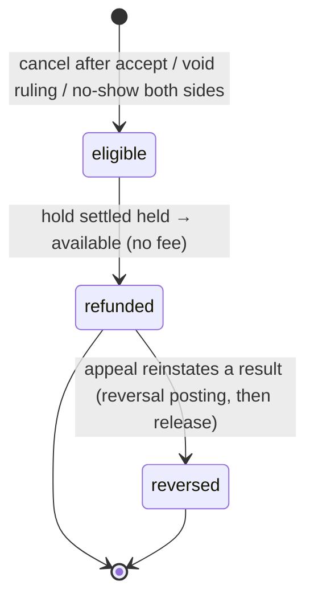

# 0006 — Ledger, wallet provider and Stage 2 money flows

- Status: **Decided** for the ledger and provider shape (2026-11-17, Sprint 13). The withdrawal, refund and payout state machines below are **designed, not built** (PRD: "Designed but not built until Stage 2").
- Open, never defaulted: fee percentage and who pays, stake-tier limits, refund and void treatment, withdrawal fees (PRD "Revenue model", owner); custody model and payment provider (legal track).
- Code: `apps/api/src/ledger/`, `apps/api/src/wallet/`, migration `0014_sprint13_ledger.sql`.

## Ledger (F13.1)

| Rule                                                                  | Where it is enforced                                                                                                                  |
| --------------------------------------------------------------------- | ------------------------------------------------------------------------------------------------------------------------------------- |
| Double entry: each transaction's entries sum to zero, in one currency | Deferred constraint trigger `ledger_entries_balanced` (at commit), and `normalisePosting` before any write                            |
| Immutable: corrections are reversing transactions                     | `BEFORE UPDATE OR DELETE` triggers on `ledger_entries` and `ledger_transactions`; a reversal points at its original, once (unique FK) |
| Idempotent: every money movement has a key                            | Unique `ledger_transactions.idempotency_key`. A replay returns the original; the same key with different contents is refused (409)    |
| No overdraft outside clearing accounts                                | Accounts locked `FOR UPDATE` in id order before balances change, plus a `CHECK (allow_negative OR balance_minor >= 0)`                |
| Integer minor units with an ISO 4217 code; no floats                  | `bigint` columns; currency `CHECK` constraints; `Number.isSafeInteger` in the posting rules                                           |
| Books net to zero                                                     | Nightly BullMQ job (02:00 Lagos) runs `checkInvariants`; an imbalance logs `ledger.imbalance` (the M4 alert contract)                 |

Accounts: `user:<id>:available`, `user:<id>:held`, `platform:fees`, and `provider:<name>:clearing`, which mirrors money held outside the platform and is the only account that may go negative. Holds are entries (available → held), as the TA specifies, with one `ledger_holds` row per player per challenge to track settlement.

Evidence: 10,000-posting fuzz runs on three seeds (`ledger.math.test.ts`); integration tests for SQL immutability, the commit-time balance check, idempotent replays, 20 concurrent holds against a balance that covers 10, webhook replay, and the net-zero check (`sprint13.integration.test.ts`).

## Provider port (F13.2)

`WalletProviderPort`: `hold`, `release`, `refund`, `reverse`, `applyCallback`. Stage 1 registers only `MockProviderAdapter`, which posts to the ledger directly. The registry returns a live adapter only when one is registered **and** `live_wallet_provider` is on for the stage and the player's state, so Stage 1 always resolves to the mock (tested).

Every challenge runs through the wallet consumer: holds on `challenge.accepted`, release on `match.confirmed` and `match.forfeited`, refund on `match.cancelled`, a draw or a void ruling, and a reversal when an appeal changes the outcome (`dispute.ruled.ratingAction`, the Sprint 9 contract). With a zero stake the adapter posts nothing, so the Stage 2 change is the adapter plus the flag.

Webhooks: `POST /webhooks/providers/:provider`, with an HMAC-SHA256 signature over `<timestamp>.<raw body>` and a 5-minute tolerance. The event is stored under a unique `(provider, event_id)` key and applied in the same transaction, so a replay is a no-op. The mock's secret is refused in production, and without a secret the route returns 404.

## Stake limits and flags (F13.3, F13.4)

The order of checks (`stake-policy.ts`) is: self-exclusion, then currency allowed in the player's state, then the lowest applicable cap (tier rule plus restriction rules such as `fraud_limited` from F12.4), then real money enabled for the stage and state. Caps come before the money flag, so a Stage 1 stake above the cap is refused as "above your limit", which proves the wiring. A missing tier rule means no stakes (fail closed).

Seeded placeholder caps (NGN minor units, owner decision pending): tier0 0, tier1 ₦1,000, tier2 ₦10,000, tier3 ₦50,000, `fraud_limited` 0, `self_excluded` 0. Flags: `currency:NGN` on for stages 1 and 2; `real_money_stakes`, `live_wallet_provider` and `responsible_gaming_settings` off. A row for a specific state overrides the default row. Fee schedule v1 (0 bps) is active; v2 is seeded inactive with `status: owner_decision_pending`.

Custody and licensing gate Stage 2 on the legal track. No code assumes either.

## Stage 2 state machines (F13.6) — designed, not built

Shared rules: every transition is an idempotent ledger posting or a no-op; every state change writes an audit-log line; amounts above the review threshold, and accounts with open disputes, active sanctions or fraud signals, stop in `review` for a human; all limits are data (`stake_limit_rules` and new withdrawal-limit rows), never code.

### Withdrawal

```mermaid
stateDiagram-v2
  [*] --> requested: player asks (KYC tier ≥ 2, within limits)
  requested --> review: over threshold / risk signal
  requested --> approved: auto-approve rules pass
  review --> approved: moderator approves (2nd person over the high threshold)
  review --> rejected: moderator rejects (reason required)
  approved --> processing: funds moved available → pending_withdrawal; sent to provider
  processing --> paid: provider webhook "withdrawal.paid" (signed, idempotent)
  processing --> failed: provider webhook "withdrawal.failed" / timeout
  failed --> approved: retry (same idempotency key)
  failed --> reversed: give up — pending_withdrawal → available
  rejected --> [*]
  paid --> [*]
  reversed --> [*]
```

Review checklist (legal track): KYC tier and age verified; destination account name matches the verified identity; no open dispute or hold on the account; within daily and monthly withdrawal limits; withdrawal fee per the owner decision; a second approver above the high threshold.

### Refund (stake returned without a result)

Built in Sprint 13 at the ledger level (`refund`, `reverse`). Stage 2 adds the player-visible receipt and whether a void carries a fee (owner decision: "refund and void treatment").

### Payout (winnings to the player)

```mermaid
stateDiagram-v2
  [*] --> pending: result confirmed / ruling final
  pending --> held_for_dispute: dispute or appeal window open
  held_for_dispute --> pending: dispute closed for this side
  held_for_dispute --> cancelled: ruling flips (reversal posting)
  pending --> released: pot − fee → winner available; fee → platform
  released --> clawed_back: later fraud finding (reversal, may push the user into review)
  released --> [*]
  cancelled --> [*]
  clawed_back --> [*]
```

Sprint 13 releases on confirmation, as the TA specifies. Whether Stage 2 holds payouts until the appeal window closes (`held_for_dispute`) is a product decision for the Stage 2 gate. The reversal path already exists either way.
